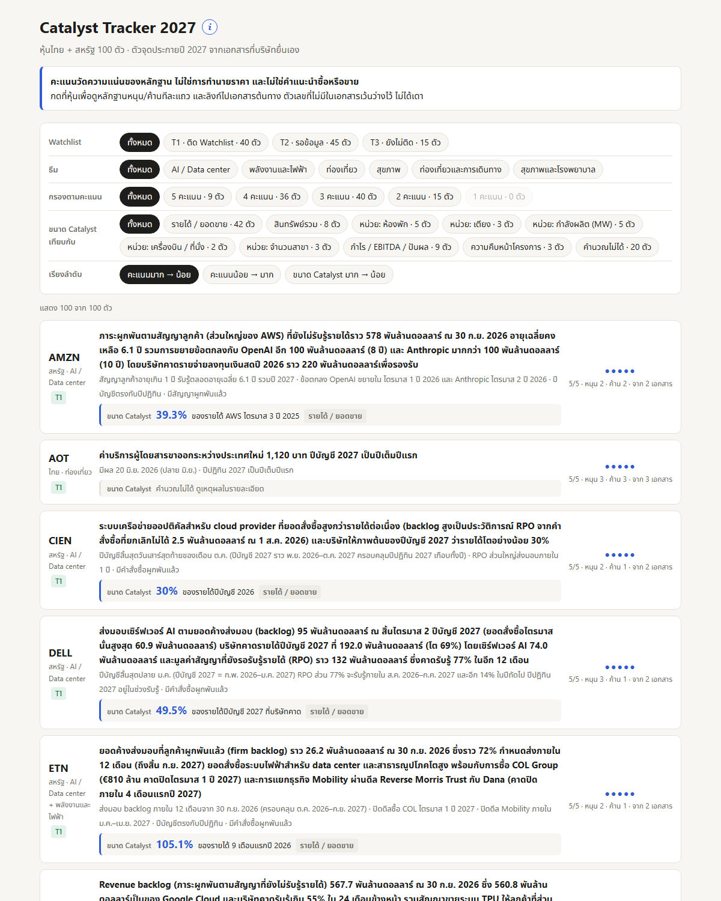
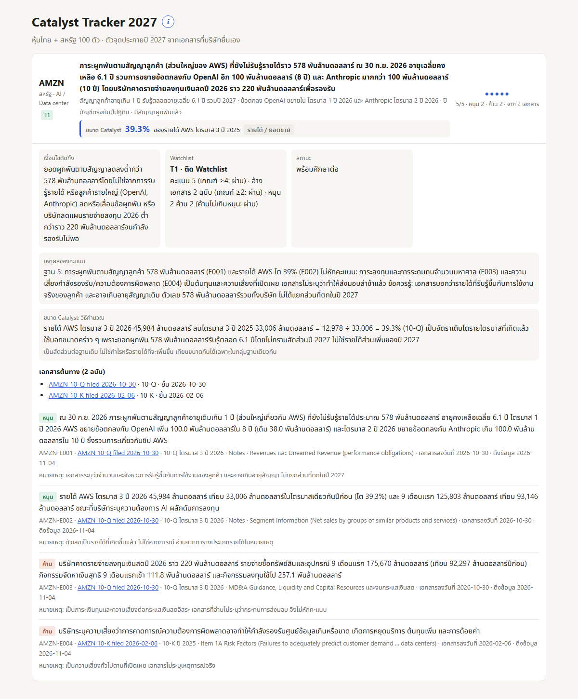

# output/

ใส่ผลงานของคุณที่นี่

- ภาพหน้าจอ dashboard หรือผลวิเคราะห์ (`.png`, `.jpg`)
- ลิงก์ผลงานที่เปิดดูได้ (เขียนไว้ในไฟล์นี้)
- ไฟล์ผลลัพธ์เล็ก ๆ ที่สร้างเอง เช่น `dashboard.html`

ห้ามใส่: ไฟล์ข้อมูลดิบที่ซื้อมา (เช่น SETSMART), บทวิเคราะห์โบรกเกอร์, ข้อมูลพอร์ตจริง

## ลิงก์ผลงาน

- เว็บออนไลน์: https://toroteraphon.github.io/aia-hw-toro/output/ (GitHub Pages อัปเดตตามทุกครั้งที่ push)
- [index.html](index.html): เว็บ Catalyst Tracker 2027 ดาวน์โหลดแล้วเปิดในเบราว์เซอร์ได้เลย ไม่ต้องมี server (เปิดผ่านเว็บจะดึง `data.json` สด เปิดจากไฟล์ในเครื่องจะใช้สำเนาที่ฝังไว้)
- [data.json](data.json): ข้อมูลหุ้นทั้งหมด แต่ละตัวมีตัวจุดประกาย คะแนน เงื่อนไขตัดทิ้ง สถานะ และหลักฐานซ้อนอยู่ข้างใน (อ้าง doc_id ใน [../data/sources.json](../data/sources.json))

*ภาพหน้าจอ ณ 5 พ.ย. 2026 (`dashboard.png`) ภาพนี้ไม่อัปเดตเอง ถ้าหน้าเว็บเปลี่ยนมากให้ถ่ายใหม่*

*ตัวอย่างการ์ดหุ้นที่กางออก (`dashboard-card.png`) ถ่ายจากหน้าเว็บเดียวกัน โดยซ่อนส่วนอื่นเพื่อให้เห็นการ์ดเต็ม*

`index.html` สร้างจาก `data.json` ด้วย `python scripts/build_site.py` ห้ามแก้ไฟล์นี้ตรง ๆ เพราะจะถูกเขียนทับ
